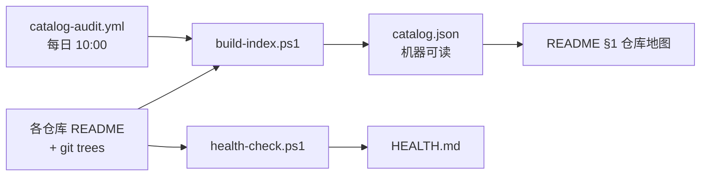

<div align="center">

# XHTFPS · 嵌入式 / AI 视觉项目库

**一个项目一个仓库：定位、边界、体积与体检结果都在这张地图里**


[项目库站点](https://xhtfps.github.io/xhtfps/) · [仓库地图](#1-仓库地图) · [仓库边界](#2-容易混的仓库边界在哪) · [格式规范](REPO-STANDARD.md)

</div>

## 这个仓库解决什么

仓库一多，最先失控的不是代码，而是**边界**：同一份模板存了三份、同一个坑在五个 README 里各写一遍、半年后不知道某个仓该不该删。这里用一张自动生成的仓库地图 + 一份格式规范，把「哪个仓负责什么、体积多大、状态如何」固定下来。

## 亮点

- **地图自动生成**：`catalog.json` 是唯一数据源，README 表格由 `tools/build-index.ps1` 重写，不手改。
- **每日体检**：`catalog-audit.yml` 每天北京时间 10:00 重跑索引与 `health-check.ps1`，有变化自动提交结果。
- **边界可判定**：容易混的 10 组仓库写明区分口径（按板卡 / 按赛事 / 自己写的 vs 厂商资料）。
- **体积可追溯**：每次瘦身都留 `base_commit`，`notes/offload.json` 点开即能取回，不做 force push。

## 结构



<!-- CATALOG:START -->
## 1. 仓库地图（24 个内容仓库 + 本索引）

> 本节由 `tools/build-index.ps1` 生成，请勿手改；新增或改动仓库后重跑脚本。公开 11 个 / 私有 13 个。

### 1.1 板卡工程集（6）

| 仓库 | 定位 | 可见性 | 芯片 / 板卡 | 技术栈 | 体积 | 状态 |
| --- | --- | --- | --- | --- | --- | --- |
| [esp32-k230-ai](https://github.com/xhtfps/esp32-k230-ai) | ESP32-S3 与 K230 双板协作的边缘 AI 视觉工程（双板联调、机器人集成、语音交互） | 公开 | ESP32-S3 + K230 / 自制双板 | ESP-IDF · CanMV MicroPython | 47 MB | 维护中 |
| [freertos-labs](https://github.com/xhtfps/freertos-labs) | STM32F407 + FreeRTOS 课程实验全集（00 工程模板 + 01-10 实验） | 公开 | STM32F407ZGT6 / 正点原子 探索者 V3 | Keil MDK · FreeRTOS 10 | 142 MB | 已完成 |
| [stm32-cubemx-labs](https://github.com/xhtfps/stm32-cubemx-labs) | STM32 CubeMX HAL 工程集（LED/KEY/TIM/USART/ADC/FreeRTOS）与标准外设库工程模板 | 公开 | STM32（型号见各工程） / 无固定板卡 | CubeMX HAL · 标准外设库 | 228 MB | 新建 |
| [stm32f4-projects](https://github.com/xhtfps/stm32f4-projects) | STM32F407 工程集：基地调试程序（5 个子工程）、工程模板、往年与电赛题目 | 公开 | STM32F407ZGT6 / 正点原子 探索者 V3 | Keil MDK · HAL/标准库 | 219 MB | 维护中 |
| [stm32h7-projects](https://github.com/xhtfps/stm32h7-projects) | STM32H743 工程集：裸机、FreeRTOS、LVGL 模板，LTDC 液晶驱动，谐波测量结项 | 公开 | STM32H743 / AT070TN83 7 寸屏 | Keil MDK · HAL · FreeRTOS · LVGL | 56 MB | 维护中 |
| [zynq-fpga-projects](https://github.com/xhtfps/zynq-fpga-projects) | ZYNQ-7020 FPGA 基础工程集：呼吸灯、按键、数码管、RAM/FIFO/时钟 IP 核 | 公开 | ZYNQ-7020 / 正点原子 领航者 | Vivado · Verilog/VHDL | 72 MB | 维护中 |

### 1.2 具体项目（7）

| 仓库 | 定位 | 可见性 | 芯片 / 板卡 | 技术栈 | 体积 | 状态 |
| --- | --- | --- | --- | --- | --- | --- |
| [dance-robot-esp32](https://github.com/xhtfps/dance-robot-esp32) | ESP32 舞蹈机器人：主控固件、视觉模块、机械固件与比赛文档 | 公开 | ESP32 / 自制舞蹈机器人整机 | ESP-IDF · 舵机控制 | 20 MB | 维护中 |
| [fad-vision-research](https://github.com/xhtfps/fad-vision-research) | 跨域目标检测研究：ACDC 基准实验、FAD 频域自适应检测、AFPN 参考实现与评估脚本 | 私有 | GPU 训练环境 / ACDC 数据集 | PyTorch · ACDC/FAD/AFPN | 94 MB | 进行中 |
| [lissajous-figure-device](https://github.com/xhtfps/lissajous-figure-device) | 2026 电赛 F 题：基于 STM32F407 的李萨如图形显示控制装置 | 公开 | STM32F407 / 自建装置（DAC 输出） | Keil MDK · DAC/DMA | 14 MB | 维护中 |
| [nir-moisture-meter](https://github.com/xhtfps/nir-moisture-meter) | 在线式双波长近红外水分仪：STM32 固件 + 上位机 + Modbus 协议 + 硬件/EDA 交付资料 | 私有 | STM32 / 自建近红外水分仪 | Keil MDK · Modbus · 上位机 | 28 MB | 维护中 |
| [RLC_dac_study_flash](https://github.com/xhtfps/RLC_dac_study_flash) | RLC 阻抗测量仪（结项）：F407 DAC 激励 + 双 ADC 采样 + FFT 解算，附 AD9959/ADF4351/AD8370 驱动与 CMSIS-DSP | 公开 | STM32F407ZGT6 / 基地板 | Keil MDK · HAL · CMSIS-DSP | 28 MB | 已完成 |
| [smart_robot](https://github.com/xhtfps/smart_robot) | 智能机器人（软件侧）：语音交互 + Whisper 识别 + GPT-SoVITS 合成 + OpenCV/YOLO 视觉 + URDF 模型 | 私有 | PC（外接麦克风/摄像头） / — | Python · Whisper · GPT-SoVITS · YOLO | 52 MB | 维护中 |
| [STM32F407-LVGL-SSD1963](https://github.com/xhtfps/STM32F407-LVGL-SSD1963) | 六足平衡机器人（STM32F407 + LVGL + SSD1963 + PS2 手柄 + 触摸屏 UI） | 私有 | STM32F407ZGT6 / 六足机器人自建板 | Keil MDK · LVGL · SSD1963 | 57 MB | 维护中 |

### 1.3 竞赛与课程（5）

| 仓库 | 定位 | 可见性 | 芯片 / 板卡 | 技术栈 | 体积 | 状态 |
| --- | --- | --- | --- | --- | --- | --- |
| [dl-pytorch-course](https://github.com/xhtfps/dl-pytorch-course) | PyTorch 深度学习课程：CNN/LSTM 代码、数据与课堂笔记 | 公开 | PC/GPU / — | PyTorch 2.x · CNN/LSTM | 36 MB | 已完成 |
| [electronics-competition](https://github.com/xhtfps/electronics-competition) | 电赛/校赛项目与资料库：示波器、信号发生器、超声波测距、2025 G 题（含第三方资料，私有） | 私有 | STM32F407 等 / 历年赛题平台 | Keil MDK · STM32 | 132 MB | 维护中 |
| [math-modeling-2025](https://github.com/xhtfps/math-modeling-2025) | 2025 数模 B 题代码：学生成绩与焦虑相关问题 Q1-Q4（Python） | 私有 | PC / — | Python · 数模求解 | 3 MB | 已完成 |
| [opencv-basics](https://github.com/xhtfps/opencv-basics) | OpenCV + Python 图像处理入门代码与示例 | 公开 | PC / — | Python · OpenCV | 1 MB | 已完成 |
| [shuweibei-cup-b2026](https://github.com/xhtfps/shuweibei-cup-b2026) | 2026 数维杯国际赛 B 题：四问求解代码、模型推导报告、论文多版修改稿与支撑材料 | 私有 | PC / — | Python · 数模求解 | 129 MB | 进行中 |

### 1.4 资料库（4）

| 仓库 | 定位 | 可见性 | 芯片 / 板卡 | 技术栈 | 体积 | 状态 |
| --- | --- | --- | --- | --- | --- | --- |
| [hardware-course-materials](https://github.com/xhtfps/hardware-course-materials) | 硬件零基础课程资料：课件、Multisim 仿真工程、OrCAD/Altium 封装库与辅助表格 | 私有 | — / 硬件零基础课程 | Multisim · OrCAD/Altium（只读） | 14 MB | 只读归档 |
| [stm32f4-reference-materials](https://github.com/xhtfps/stm32f4-reference-materials) | STM32F407 参考资料与例程：基地板调试程序、AD9959、LVGL、FreeRTOS 模板、示波器工程 | 私有 | STM32F407 / 本机资料盘归档 | 例程/手册（只读） | 200 MB | 只读归档 |
| [stm32f407-board-materials](https://github.com/xhtfps/stm32f407-board-materials) | 正点原子探索者 V3（STM32F407ZGT6）开发板资料：文档、原理图、例程与硬件资料 | 私有 | STM32F407ZGT6 / 正点原子 探索者 V3 | 厂商文档/原理图/例程（只读） | 104 MB | 只读归档 |
| [zynq-navigator-board](https://github.com/xhtfps/zynq-navigator-board) | 正点原子领航者 ZYNQ 开发板资料索引：教程、原理图、引脚表、FPGA/Vitis/Linux 源码（第三方资料） | 私有 | ZYNQ-7020 / 正点原子 领航者 | 厂商文档/源码（只读） | 52 MB | 只读归档 |

### 1.5 支撑库（2）

| 仓库 | 定位 | 可见性 | 芯片 / 板卡 | 技术栈 | 体积 | 状态 |
| --- | --- | --- | --- | --- | --- | --- |
| [bsp-libs](https://github.com/xhtfps/bsp-libs) | 嵌入式驱动库与板级硬件约定（drivers/ + hardware/pinmap.csv/BOM.csv） | 私有 | — / — | C · PowerShell · CSV | 120 KB | 在建 |
| [notes](https://github.com/xhtfps/notes) | 嵌入式调试知识库：跨仓排错速查 + 手册索引（脚本生成） | 私有 | — / — | Markdown · PowerShell | 263 KB | 在用 |

> 体积 = HEAD 检出文件的真实体积（`git/trees?recursive=1` 求和）；`diskUsage`（含历史）仅作回退。分类、芯片、状态的权威口径在 `tools/catalog-rules.json`。

<!-- CATALOG:END -->

## 2. 容易混的仓库，边界在哪

| 容易混 | 区分口径 |
| --- | --- |
| `stm32f4-projects` / `stm32f4-reference-materials` | 前者是整理后的工程集（只留源码、按工程组织），后者是本机资料盘**原样备份**（含例程、手册、旧工程，不做二次整理） |
| `stm32f4-projects` / `stm32f407-board-materials` | 前者是“我自己写的工程”，后者是“厂商原始资料与手册” |
| `stm32f4-projects` / `electronics-competition` | 前者按**板卡**归口（模板、基地调试、历年题目），后者按**赛事**归口（历次竞赛的完整资料） |
| `lissajous-figure-device` / `electronics-competition` | 前者是 2026 F 题单独立项的项目仓，后者是历年赛题资料合集 |
| `zynq-fpga-projects` / `zynq-navigator-board` | 前者是“我写的 FPGA 工程”，后者是“厂商板卡资料” |
| `esp32-k230-ai` / `dance-robot-esp32` | 前者是双板协议与联调（K230 侧 + ESP32 侧），后者是舞蹈机器人整机；整机代码已从前者移除，只在后者维护 |
| `RLC_dac_study_flash` / `electronics-competition` | 前者是单一结项仪器，后者是资料合集；信号源、示波器内容不在两处重复存放 |
| `smart_robot` / `dance-robot-esp32` / `STM32F407-LVGL-SSD1963` | 三个机器人仓：软件侧语音视觉（PC）/ ESP32 舞蹈机器人整机 / F407 六足硬件 |
| `freertos-labs` / `stm32f4-projects` | 前者按实验编号组织，后者按工程组织；FreeRTOS 模板只在 `freertos-labs/00` 维护一份 |
| `stm32f4-projects` / `stm32-cubemx-labs` | 前者是 F407 单板工程集，后者是跨芯片的 CubeMX 学习工程与标准库模板 |

## 3. 仓库惯例

- **一项目一仓库**：同一块板卡的工程放同一仓库，不再按“每次实验一个仓库”拆分。
- **一仓库一 README**：五段结构（目录 / 环境 / 快速开始与关键实现 / 常见问题 / 维护说明）。
- **每个仓库都有 `LICENSE`、`.gitignore`、`.gitattributes`、≥ 3 个 topics**。
- **只存可版本化的东西**：源码、文档、小型资源入库；编译产物、固件镜像、数据集、模型权重、安装包都不入库。
- **排除清单只留摘要**：每个仓库一个 `EXCLUDED_FILES.md`，不存逐文件 CSV。
- **索引自动生成**：仓库地图只维护 `catalog.json` 与 `tools/catalog-rules.json`，README 表格交给脚本重写。

## 4. 归并记录（已完成）

| 原仓库 / 原目录 | 去向 | 核对方式 | 处理 |
| --- | --- | --- | --- |
| `01_…` ～ `10_…`（10 个 FreeRTOS 实验） | `freertos-labs/01`–`10` | 逐文件 SHA 比对：05–10 完全一致；01–04 差异仅为 `Output/` 编译产物 | 仓库已删除 |
| `freertos_project_template` | `freertos-labs/00_freertos_project_template` | 源码一致，差异仅 `uvoptx/uvguix/JLinkLog` 等 Keil 用户配置与日志 | 仓库已删除 |
| `STM32project` | `stm32f4-projects/基地调试程序` | 86 个用户代码文件均有同名演进版；旧工程与参考资料完整保留在 `往年题目/超声波测距` | 仓库已删除 |
| `k230-esp32-vision-link` | `esp32-k230-ai/K230+ESP32/ESP32` | 224 个同名文件中 220 个在新仓库，`components/BSP`、`docs`、`tests` 齐全 | 仓库已删除 |
| `dancing-robot-multimodal` | 无需并入 | 仅 9 个 ESP-IDF 骨架文件，无源码 | 仓库已删除 |
| `esp32-k230-ai/robot/`（整机副本） | `dance-robot-esp32` | 9 个文件的同名对应全部存在，且完整工程含 `eyes`/`jx_firm`/答辩材料 | 子目录已移除，README 留跳转 |

**28 → 14 → 21 → 23（22 内容 + 1 索引）**：14 个归档空壳全部删除；随后本机资料盘归档与新项目拆仓补入 7 个仓库（5 个新项目/课程仓 + 2 个资料库仓）。当前为 **22 个内容仓库 + 本索引**，新增的 `stm32-cubemx-labs`、`shuweibei-cup-b2026` 已由 `catalog.json` 自动收录，不再依赖手改表格。删除前已记录各仓库 HEAD SHA，90 天内可通过 GitHub Support 恢复，清单见 `GitHub仓库合并记录-2026-11-23.md`。

## 5. 已完成的整理

**第一轮（归并与文档）**：28 → 14，逐文件内容比对后合并；仓库重写 README；修正 11 处乱码描述。

**第二轮（格式统一）**：补齐 `LICENSE`/`.gitattributes`/`.gitignore`/topics；清理垃圾生成物（JLinkLog、uvguix、uvoptx、`(1)` 重复文件）；4 个结项仓库发 Release；`code` 改名 `math-modeling-2025`。

**第三轮（体积与清单）**：

- `dl-pytorch-course`：删除 CIFAR-10 原始批次（186 MB），改为下载说明。
- `STM32F407-LVGL-SSD1963`：删除未启用的 LVGL `demos/`（56.6 MB）。
- 6 个仓库的逐文件 `EXCLUDED_MANIFEST.csv`（合计 **8.2 MB**）全部改为 `EXCLUDED_FILES.md` 摘要。
- `REPO-STANDARD.md` 补上体积红线、数据集规则、目录深度上限。
- 新增 `tools/repo-audit.ps1`（全库合规体检）与 `tools/slim-history.ps1`（历史重写瘦身）。

**第四轮（索引自动化）**：

- 新增 `tools/build-index.ps1`：扫描全部仓库，读取 README 环境段与关键词，生成 `catalog.json`，并重写本文 §1 的四张表；`-RenderOnly` 可离线重排。
- 新增 `tools/catalog-rules.json`：分类、芯片、板卡、状态的人工口径，优先于自动识别结果。
- 修正索引落后问题：`stm32-cubemx-labs`、`shuweibei-cup-b2026` 纳入仓库地图。
- 修复 `stm32f4-projects` README 的 `EXCLUDED_MANIFEST.csv` 死链，删除仓库内 1.4 MB 的芯片手册 PDF。
- `stm32-cubemx-labs` 的 10 MB 逐文件清单 `EXCLUDED_MANIFEST.csv` 改为 `EXCLUDED_FILES.md` 摘要。

**第五轮（数据库化）**：把“整理好的文件柜”变成“可查询的库”。

- 新增 [`bsp-libs`](https://github.com/xhtfps/bsp-libs)：`drivers/<chip>/` 一颗芯片一份驱动（已迁 AD9959、ADS1256、MPU6050），配 `driver.json` 元数据；`hardware/<board>/pinmap.csv` + `BOM.csv` 描述接线与器件；`tools/check-driver.ps1` 校验引脚落地与文件存在性。
- 新增 [`notes`](https://github.com/xhtfps/notes)：`troubleshooting.md`（83 条跨仓排错，脚本从各仓 README 抽取）+ `manuals.md`（仓内现存 110 个 PDF + 已移出 253 个 PDF/570.5 MB 的带链接台账），生成脚本 `tools/build-notes.ps1`。
- 索引自动化收尾：`catalog.json` 改用真实 HEAD 体积（`git/trees` 求和）与 `diskUsage` 双口径；`build-index.ps1` 修掉 `size` 字段取值错误。
- 新增 `tools/health-check.ps1` 与 `.github/workflows/catalog-audit.yml`：每天北京时间 10:00 自动重跑索引与体检，有变化自动提交 `catalog.json` / `README.md` / `HEALTH.md`。
- 统一 topics：`TOPICS.md` 定词表，`tools/set-topics.ps1` 已按词表重写全部 25 个仓的标签。

**第六轮（大仓瘦身，已执行两轮）**：全库 HEAD 从 **2,933 MB** 降到 **1,728 MB**，超 200 MB 的仓从 7 个降到 2 个。所有移出都走“普通提交 + 历史保留”，被移文件的 `base_commit` 与原路径逐条记在 [`notes/offload.json`](https://github.com/xhtfps/notes/blob/main/offload.json)，点开即能取回，不做 `force push`、不毁历史。

| 轮次 | 仓库 | 移出内容 | 省下 | 提交 |
| --- | --- | --- | --- | --- |
| 1 | `zynq-navigator-board` | Vivado 工程产物 5,345 个（`.runs/.cache/.sim/.hw/.ip_user_files`、`.dcp/.jou/.log`） | 132 MB | `3a8be384` |
| 1 | `zynq-navigator-board` | PDF 89 个 | 296 MB | `0be70b2a` |
| 1 | `stm32f407-board-materials` | PDF 133 个 | 190 MB | `785919ed` |
| 1 | `stm32f4-reference-materials` | LVGL `demos/` 副本、PDF 16 个 | 122 MB + 54 MB | `5c246df0` / `7105517a` |
| 1 | `smart_robot` | Python `venv` | 38.5 MB | `7c625509` |
| 1 | `stm32-cubemx-labs` | CMSIS 重复副本、逐文件清单 CSV | 13 MB + 10 MB | `91daec0d` |
| 1 | `electronics-competition` | 历史拷贝 `.zip` 与 `uvguix` 垃圾 | 6.9 MB | `cf9f7b00` |
| 1 | `shuweibei-cup-b2026` | 重复输出 PDF 69 个 | 60.5 MB | `04801294` |
| 2 | `stm32f4-projects` | 参考资料 PDF 15 个 | 31 MB | `09a78eb9` |
| 2 | `electronics-competition` | ST StdPeriph 标准库副本 3,150 个文件（ST 官网可重下） | 79 MB | `a2ab4a6e` |
| 2 | `smart_robot` | 预训练权重 `firefly_e10_s1110.pth`、`yolo26s.pt`×2 与 `pcd_data` 图片集 | 200 MB | `fa24a3db` |

取舍口径：**项目/竞赛仓里用户自己写的论文、题目、报告一律不删**（论文是成果本身）；只移厂商手册、上游可重下的库、预训练权重与数据集，并在台账留旧提交直链。方案与“为什么不再继续删”的边界见 [`SLIM-PLAN.md`](SLIM-PLAN.md)。

## 6. 缺陷与处置状态

| # | 问题 | 状态 | 处置 |
| --- | --- | --- | --- |
| 1 | 全库 HEAD 1,728 MB，仍有 2 个仓 ≥ 200 MB（`stm32-cubemx-labs` 228、`stm32f4-projects` 219） | **未解决**（策略性保留） | 剩下的是各工程自带的 HAL/CMSIS，删了工程编不动；再降只能抽公共库或 history rewrite，见 [`SLIM-PLAN.md`](SLIM-PLAN.md) |
| 2 | 同一手册在多个仓各存一份 | 已解决 | 手册全部移出仓，统一进 [`notes/manuals.md`](https://github.com/xhtfps/notes/blob/main/manuals.md) 台账，仓里只留链接 |
| 3 | `smart_robot` 权重/数据集移出后，clone 下来跑不起来 | 已解决 | 台账补记 25 个文件（`kind=trim`），新增 `notes/tools/fetch-assets.py`；一条命令按 `base_commit` 取回，README 已指过去 |
| 4 | 各工程重复的 CMSIS 副本 | **未解决** | 与 1 同源，需先把公共库抽到 `bsp-libs` |
| 5 | `electronics-competition` 同名目录嵌套、超长路径 | 部分解决 | `.gitattributes` 已开 `core.longpaths`；目录未重排 |
| 6 | 体检只查体积，不查链接是否失效 | 已解决 | 新增 `tools/link-check.py`，把 README 里的文件名与仓内 HEAD / 移出台账比对，产出 [`LINKS.md`](LINKS.md)；首次跑出 3 处死链，已全部修掉，现为 0 |
| 7 | 数据只有仓级粒度，问不到“芯片—引脚—驱动—落点” | 已解决 | 新增 `tools/build-db.py` → [`embedded.db`](embedded.db) 六张表；`tools/db.py` 提供 `repo/driver/pin/doc/trouble/usage/sql` 七个子命令 |
| 8 | 没有查询入口，只能人眼看 JSON | 已解决 | `db.py` 命令行 + 豆包 Skill（见 §9）；CI 每夜重建并自检 |
| 9 | AD9959 与 ADS1256 引脚硬冲突（PF2/PF4 双用） | 已解决（方案级） | [`bsp-libs/hardware/PIN-CONFLICTS.md`](https://github.com/xhtfps/bsp-libs/blob/main/hardware/PIN-CONFLICTS.md) 给出三条路线；方案 A 落成 `example_f407_dual` **v2**（ADS1256 只挪 SCLK→PF7、DOUT→PF9，驱动改两个宏），SPI1 版本降为备选；**未上板验证** |
| 10 | 分支保护未开 | 有意不改 | 单人仓库开了会阻塞自己 push，靠提交习惯约束 |
| 11 | 所有写操作依赖本机 token，且本机 `github.com` 被 DNS 污染 | 部分缓解 | 读侧全部有 CI 兜底（每夜重建 catalog/HEALTH/LINKS/embedded.db）；本地脚本必须先 `NO_PROXY='*'` 清代理 |

## 7. 命名约定

见 [`REPO-STANDARD.md`](https://github.com/xhtfps/xhtfps/blob/main/REPO-STANDARD.md)：芯片类 `<芯片>-<主题>`，项目类全小写连字符，禁用 `code`/`test`/`new`/`temp`。

## 8. 索引维护

```powershell
# 全量：拉取账号下全部仓库（需 gh auth login 或 $env:GITHUB_TOKEN）
pwsh -File .\tools\build-index.ps1

# 离线：只按 catalog.json 重排 README 表格
pwsh -File .\tools\build-index.ps1 -RenderOnly

# 体检 + 索引一起跑
pwsh -File .\tools\health-check.ps1

# README 引用体检（产 LINKS.md / links.json）
python .\tools\link-check.py

# 重建查询库（产 embedded.db）
python .\tools\build-db.py

# 按 TOPICS.md 词表重写全部仓库的 topics（-DryRun 只看不写）
pwsh -File .\tools\set-topics.ps1 -DryRun

# 大仓瘦身：先只读看前 20 大文件，确认路径再加 -Apply
pwsh -File .\tools\slim-history.ps1 -Repo zynq-navigator-board
```

新增仓库时只改 `tools/catalog-rules.json` 的分类口径，再重跑脚本；不要手改 §1 的表格。`catalog-audit` 工作流已在跑（每天北京时间 10:00，依次重建 catalog → HEALTH → LINKS → embedded.db 并自检），若首次运行失败，去 Settings → Actions → General 把 Workflow permissions 设为 “Read and write permissions”。

## 9. 查询库与豆包接入

`embedded.db` 是 SQLite，25 个仓的全部结构化信息都在这六张表里；`db.py` 是它的命令行门面。

| 表 | 行数 | 内容 |
| --- | --- | --- |
| `repos` | 25 | 仓库级元数据：分类、芯片、板卡、技术栈、状态、`status_since`、HEAD 体积、topics |
| `drivers` | 3 | `bsp-libs` 驱动：芯片、接口、平台、源仓与源文件、坑注 |
| `pins` | 63 | 信号—引脚：`driver_id / board / net / mcu_pin / direction`，board 为空表示驱动要求、未接线 |
| `docs` | 388 | 手册与资料：`state=head` 在仓内、`state=offloaded` 已移出（`url` 指向 `base_commit`） |
| `troubles` | 83 | 跨仓排错：现象 / 原因解法 / 来源仓 |
| `usages` | 117 | 驱动落点：哪颗驱动在哪个仓的哪个路径出现过（实测 AD9959 分散在 8 个仓、30+ 份副本） |

常用查询（在本机加 `--json` 可给程序用）：

```powershell
python .\tools\db.py stats
python .\tools\db.py driver ads1256        # 驱动详情 + 各板引脚
python .\tools\db.py pin PF4               # 反查：谁占了 PF4
python .\tools\db.py usage ad9959          # 这颗芯片在哪些仓里出现过
python .\tools\db.py doc 参考手册 --all     # 含已移出的手册
python .\tools\db.py trouble J-Link        # 排错速查
python .\tools\db.py sql "select repo,head_mb from repos where head_mb>150"
```

**豆包接入**：已装了一个 Skill（`doubao-embedded-db`），它会先 `embedded.db` 拉到本地缓存再查询。你直接问就行，例如：

- “ADS1256 的 DOUT 接哪个脚、哪块板验证过”
- “AD9959 驱动在哪些仓里有副本”
- “上次那个 J-Link 连不上的问题怎么解的”
- “哪几个仓还超 200 MB、为什么没继续瘦”

口径说明：`status_since` 取“状态落定的日期”，结项/归档类目前用最近推送日近似（精确日期可在 `catalog-rules.json` 里加 `status_since` 覆盖）；`docs` 里 `offloaded` 条目的 `url` 一定指向移出前的提交，不是死链。

## 路线图

- [x] 索引与体检自动化，README 表格不再手写
- [x] 24 个内容仓统一 topics、README 五段、排除摘要
- [ ] 把「仓库外观规范」（徽章、结构图、路线图）纳入自动体检
- [ ] 继续压 `stm32-cubemx-labs`、`stm32f4-projects` 两个大仓的体积

## 参与与反馈

本仓是个人项目索引，不对外接收 PR。发现索引与实际不符，按 [Issue 模板](.github/ISSUE_TEMPLATE) 提；安全事项见 [SECURITY.md](SECURITY.md)。

## 许可证

本仓文档与脚本以 [MIT](LICENSE) 分发；被索引的各仓库按其自身许可证。
